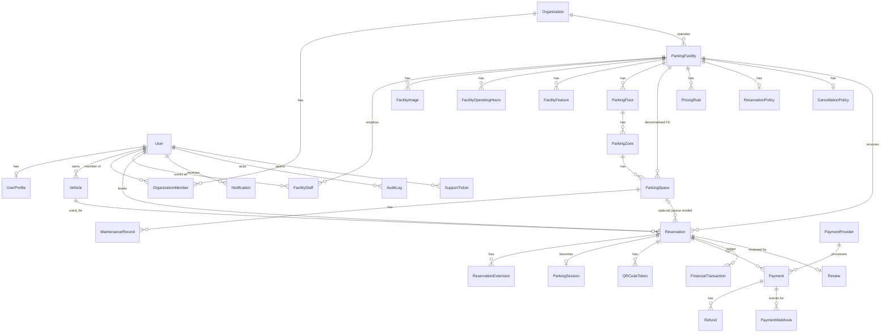
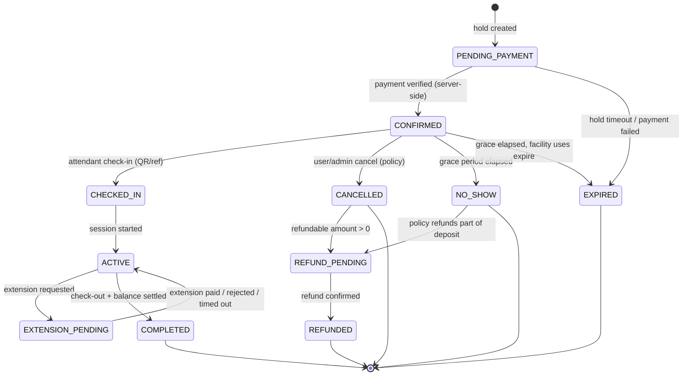

# Smart Parking Ethiopia — Architecture

Status: Phase 1 (Foundation) implemented. Everything else here is design.
Central promise: **select where you are going → discover available parking around that destination → reserve → arrive with parking secured.**

---

## 0. Requirement analysis: conflicts, risks, missing decisions

### 0.1 Conflicts / tensions in the spec

| # | Issue | Resolution adopted |
|---|-------|--------------------|
| C1 | §5.4 deposit-based booking vs §6 "charge actual time". | Two money concepts: **deposit** (a % of the *estimated* fee, paid up-front, credited against the final bill) and **final settlement** (actual duration priced at check-out; `final − deposit` collected). If actual < deposit, the deposit is *not* refunded by default (facility policy `depositRefundableOnEarlyExit`, default false) — needs business sign-off. |
| C2 | §3.2 "Check customers in/out, scan QR" is facility-admin **and** attendant. | Same service layer, two UIs. Attendant = `FacilityStaff` row with role ATTENDANT, scoped to facilities. |
| C3 | §11 lists `Roles` + `Permissions` tables; §13 wants RBAC. | A static role enum + membership tables (`OrganizationMember`, `FacilityStaff`) + a code-level policy matrix. A DB-driven permission table is premature; revisit when custom roles are requested. |
| C4 | Capacity-based inventory vs per-space exclusion. | Two strategies behind one `AvailabilityService` (see §4). |
| C5 | "Extension must never conflict" vs "capacity-based facilities". | Extension re-runs the same availability check for `[currentEnd, newEnd)` inside the same lock. |
| C6 | "Immediate booking" and "Advance reservation" filters. | `Facility.minAdvanceMinutes` / `maxAdvanceDays` on `ReservationPolicy`. "Immediate" = `minAdvanceMinutes = 0`. |
| C7 | "Do not claim integration complete" vs no credentials. | `PaymentProvider` interface + `MockProvider` (loudly labelled). Chapa/Telebirr only after docs + sandbox keys are verified. |

### 0.2 Technical risks

1. **Double booking** (highest). Mitigation: DB-level guarantees, not app checks (§4).
2. **Geocoding/routing ToS.** Public Nominatim forbids autocomplete-as-you-type and heavy use; public OSRM demo is not for production. Need a decision on provider (Photon/Pelias self-hosted, MapTiler, LocationIQ, Mapbox…). Addis Ababa OSM coverage of *business names* is patchy → fallback: platform-curated `Landmark` table (seeded) searched with `pg_trgm` + facility names. Adapter interfaces are in place from day one.
3. **Payment provider uncertainty.** Chapa has a public API (initialize/verify/webhook with signature); Telebirr merchant API usually needs a business onboarding. Verify against current docs in Phase 5; do not rely on memory.
4. **Refund support** differs per provider; the `Refund` model tracks `MANUAL` refunds as first-class.
5. **Next.js + background jobs.** Next route handlers are not a job runner. Jobs run as a separate Node process (BullMQ + Redis) from the same repo (`src/worker`). Hold expiry is *also* enforced lazily at query time so correctness never depends on the worker being alive.
6. **QR scanning in browser** needs HTTPS + camera permission; a manual booking-reference fallback is mandatory.
7. **SMS in Ethiopia** (Ethio Telecom / aggregators) — provider undecided; abstraction only.
8. **Connectivity.** Attendants may be on poor networks; the attendant UI must tolerate retries → all check-in/out endpoints are idempotent.

### 0.3 Business decisions needed (assumed defaults in §10)

Platform commission model (% of deposit vs % of final), settlement/payout to facilities (who holds the money? the spec has no payout flow), VAT/TOT on parking fees, whether free cancellation refunds platform fees, penalty for no-show (forfeit deposit?), whether drivers need a Fayda/phone verification, license-plate format validation.

---

## 1. Product architecture

Four experiences, one backend, one database.

```
                ┌──────────── Next.js app (modular monolith) ────────────┐
Driver web  ───▶│ (public) (driver)  (facility)  (attendant)  (admin)    │
Facility web ──▶│        route groups / separate layouts                 │
Attendant ─────▶│                                                        │
Super admin ───▶│ /api/*  route handlers → modules/* services → Prisma   │
                └───────┬───────────────┬───────────────┬────────────────┘
                        │               │               │
                 PostgreSQL+PostGIS   Redis (queue,   External: geocoder,
                 (source of truth)    rate limit)     router, payments, SMS, email
                                        ▲
                              Worker process (BullMQ): hold expiry, no-show,
                              reminders, reconciliation, notification delivery
```

### Destination-first principle (enforced in code)

* `DiscoveryQuery` requires `destination {lat,lng}`; there is **no** `userLocation` field in the discovery schema. A test asserts that supplying GPS has no effect.
* Browser geolocation may only be used for an optional "use my location **as destination**" button, which produces a normal `destination`.
* All distance sorting uses `ST_Distance(facility.location, destination)`; walking distance is a separate, optional field (`walkingDistanceM`, `walkingDurationS`) from the routing provider. They are never merged in the UI.

---

## 2. System architecture (modules)

```
src/
  app/                    UI + route handlers only. No business logic.
  modules/                One folder per bounded context; each exports a service
    auth/ users/ organizations/ facilities/ inventory/ discovery/ pricing/
    reservations/ payments/ sessions/ qr/ notifications/ analytics/ admin/ audit/
  platform/               cross-cutting: db, env, errors, http (handler wrapper),
                          rate-limit, logger, time, money
  providers/              adapters: payments/, geocoding/, routing/, sms/, email/
  worker/                 job definitions + runner (Phase 4)
```

Rules: `app/*` → `modules/*/service` → `modules/*/repo` → Prisma. Modules call each other only through services (no cross-module Prisma access). That is the seam for a later service split.

---

## 3. Database ER diagram



Key integrity constraints (implemented in the Phase 4 migration, see §4): GiST exclusion constraint on `(spaceId, tstzrange(startAt,endAt))`, unique `FinancialTransaction.reference`, unique `(provider, providerEventId)` on webhooks, unique `Payment.idempotencyKey`, `CHECK (endAt > startAt)`, `CHECK (amounts >= 0)`, GiST index on `ParkingFacility.location geography(Point,4326)`.

Money is stored as **integer cents (santim)** `Int`/`BigInt` — never floats. 1 ETB = 100 santim. Timestamps are `timestamptz` (UTC).

The full schema is in `prisma/schema.prisma`.

---

## 4. Reservation concurrency design (the hard part)

A reservation row doubles as the hold: `status = PENDING_PAYMENT` with `holdExpiresAt`.

**Individual-space model** — database exclusion constraint:

```sql
ALTER TABLE "Reservation" ADD CONSTRAINT no_space_overlap
EXCLUDE USING gist ("spaceId" WITH =, tstzrange("startAt","endAt",'[)') WITH &&)
WHERE ("spaceId" IS NOT NULL AND "blocksInventory");
```

`blocksInventory` is a boolean column maintained by the state machine (true for PENDING_PAYMENT with live hold, CONFIRMED, CHECKED_IN, ACTIVE, EXTENSION_PENDING). Two concurrent inserts for overlapping ranges: one commits, the other gets `23P01` → mapped to `409 SPACE_UNAVAILABLE`. No application-level race is possible.

**Capacity model** — constraints can't express "≤ N overlapping", so: inside one transaction take `pg_advisory_xact_lock(hashtext(facilityId))`, count blocking overlaps + maintenance blocks for the range, compare with capacity, insert. Serialised per facility; fine at the expected scale.

**Expiry** — (a) worker flips stale holds to EXPIRED and clears `blocksInventory`; (b) before any availability check in a transaction, stale holds for that facility/space are expired inline, so a dead worker cannot block inventory.

**Late payment** (success webhook after hold expiry): re-attempt the hold in a transaction; if the slot is still free, confirm; otherwise mark payment `REFUND_REQUIRED` and create a refund. Never silently confirm over a conflicting booking.

**Availability for a window** = capacity − (blocking reservations ∩ window) − (maintenance ∩ window) ... and facility must be open for the entire window, vehicle type compatible. Computed by one SQL function used by both discovery and booking so they can never disagree.

---

## 5. Reservation lifecycle



A single `transition(reservation, event, actor)` function owns the allowed-transition table; the frontend can only send *events* (`cancel`, `extend`) never a target status. Every transition writes an `AuditLog` row.

---

## 6. Payment workflow

```mermaid
sequenceDiagram
  participant D as Driver browser
  participant API as Next API
  participant DB as PostgreSQL
  participant P as Provider (Chapa/Telebirr/Mock)
  D->>API: POST /reservations/hold
  API->>DB: tx: lock + insert PENDING_PAYMENT (holdExpiresAt)
  D->>API: POST /payments/initiate {reservationId, idempotencyKey}
  API->>DB: insert Payment(INITIATED, amount computed server-side, unique ref)
  API->>P: create checkout (tx_ref = Payment.reference)
  P-->>API: checkout URL
  API-->>D: redirect URL
  D->>P: pays
  P-->>API: POST /payments/webhooks/:provider (signed)
  API->>API: verify signature, dedupe on (provider,eventId)
  API->>P: GET verify(tx_ref)  -- never trust payload alone
  API->>DB: tx: check amount/currency match, Payment=SUCCEEDED,<br/>FinancialTransaction, Reservation→CONFIRMED, QR token
  P-->>D: redirect to return_url
  D->>API: POST /payments/verify (browser return; same idempotent path)
  Note over API,DB: Reconciliation job re-verifies INITIATED/PENDING payments<br/>older than N minutes (handles "browser closed" case)
```

Invariants: amount comes only from server-side pricing; webhook + return-URL + reconciler all call the same idempotent `settlePayment(reference)`; amount mismatch → `Payment.status = AMOUNT_MISMATCH`, no confirmation, alert.

---

## 7. Folder structure (target)

See §2 for `src/`. Top level: `prisma/` (schema, migrations incl. raw SQL for PostGIS/exclusion), `docs/`, `tests/` (unit + integration), `docker/`, `docker-compose.yml`, `.env.example`.

## 8. API architecture

* Prefix `/api`, JSON only. Success: `{ "data": ..., "meta"?: { page, limit, total } }`. Error: `{ "error": { "code": "VALIDATION_ERROR", "message": "...", "details"?: ... } }` with stable machine-readable codes.
* Every handler is wrapped by `route({ auth, roles, schema, rateLimit }, fn)`: parse+validate (Zod) → authenticate → authorize (role **and** resource scope) → execute → map errors.
* Scope checks live in modules (`assertFacilityAccess(user, facilityId)`), never in the UI.
* Mutating requests: `SameSite=Lax` httpOnly cookie + `Origin` header check (CSRF), idempotency key on money endpoints.
* OpenAPI: generated from the Zod schemas (`zod-to-openapi`) in Phase 7; the endpoint list in the spec §12 is the contract, with one addition `GET /api/parking/discover` accepting **only** destination coordinates.

## 9. Roadmap and UI map

Phases 1–9 as in the spec. Page map:

* Public: `/` (destination search → results map/list), `/parking/[facilityId]`, `/login`, `/register`
* Driver: `/dashboard`, `/bookings`, `/bookings/[id]`, `/active`, `/vehicles`, `/payments`, `/profile`, `/notifications`
* Facility: `/facility`, `/facility/[id]/{inventory,layout,reservations,sessions,check-in,staff,pricing,payments,reports,settings}`
* Attendant: `/attendant` (today, scanner, lookup, active sessions)
* Admin: `/admin`, `/admin/{facilities,organizations,users,reservations,transactions,disputes,analytics,settings}`

## 10. Assumptions made (revisit)

1. Currency ETB, money in santim integers; display via `Intl` `en-ET`.
2. One user has exactly one global role (`DRIVER`, `ATTENDANT`, `FACILITY_ADMIN`, `SUPER_ADMIN`); *scope* comes from membership rows.
3. Auth: email **or** phone + password (Argon2-class hashing via bcryptjs cost 12 in Phase 1), JWT in httpOnly cookie, user re-loaded from DB per request so suspension/role changes apply immediately. Password reset and email/phone verification deferred to Phase 8 (needs notification delivery).
4. Rate limiting is in-memory in Phase 1 (single process) → Redis in Phase 4.
5. Ethiopia has no DST; Africa/Addis_Ababa = UTC+3 always.
6. Platform default hold window 10 minutes; deposit limits 10–100% (platform settings).
7. Facility registration is public but creates `PENDING_APPROVAL` records; the facility owner also becomes a `FACILITY_ADMIN`.
8. shadcn/ui components are vendored by hand in `src/components/ui` (the shadcn CLI was not used) following its conventions, so the CLI can be adopted later.
